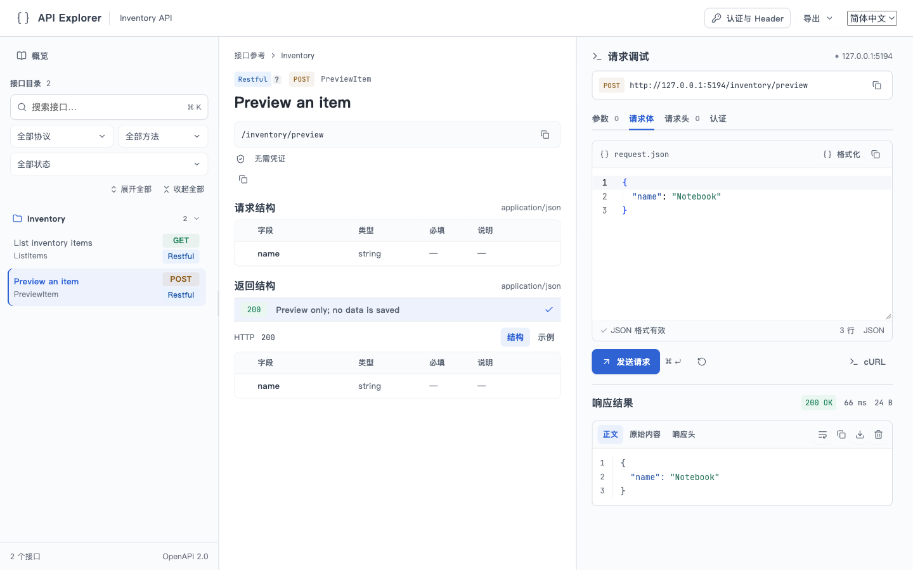

# API Explorer

基于 Swagger 的一站式扩展产品：接口文档、在线调试与 Go / TypeScript SDK 生成。安装包自带完整前端页面、全局 UI、编辑器、语言资源和字体，接入方提供 Swagger JSON 即可使用。

v0.3.0 起统一交付内置前端与 SDK 命令，旧版 v0.2.x 不包含这些入口。仓库与 Go module 地址仍为 `github.com/PerfectZQ/openapi-workbench`。

## 安装与使用

```bash
go install github.com/PerfectZQ/openapi-workbench/cmd/api-explorer@v0.3.0

# 导出随产品内置的完整前端，挂载此目录即可使用
api-explorer assets --spec /swagger/doc.json --out ./public/api-explorer

# 一条命令生成可编译的 Go 和 TypeScript SDK 工程
api-explorer sdk --spec ./swagger.json --out ./sdk
```

前端已在产品构建时生成，用户不需要 Node.js、React 或 Vite。将 `public/api-explorer/` 作为静态目录挂载到 `/api-explorer/`，页面自动加载指定的 Swagger 地址。SDK 命令默认生成两种语言；只需一种时使用 `--lang go` 或 `--lang typescript`。

Go 服务也可以直接挂载包内页面，无需导出目录：

```go
import explorer "github.com/PerfectZQ/openapi-workbench"

mux.Handle("/api-explorer/", http.StripPrefix("/api-explorer",
    explorer.Handler("/swagger/doc.json")))
```

[完整接入示例](doc/guide/quick-start.md) · [前端挂载与部署](doc/guide/frontend-resources.md) · [Swagger UI 迁移](doc/guide/swagger-ui-migration.md)

## 页面示例



示例使用虚构 Inventory 数据，仅请求本机服务。当前支持 Swagger 2.0 与已实现的 `x-api-*` 扩展；可直接读取 swag 生成的 JSON。

## 开发

```bash
./script/bootstrap.sh
GO_BIN=/path/to/go1.26.4/bin/go ./script/check.sh
./script/package.sh v0.3.0
```

开发环境为 Go 1.26.4、Node.js 24、npm。前端源码统一位于 `frontend/src/`，全局 UI 是其内部 `ui/` 目录，所有能力共用产品版本和安装包。`@api-explorer/react` 提供需要深度定制时的 React 入口，内部控件不再独立发布。

## 文档导航

- [架构与模块边界](doc/architecture/architecture.md)
- [接入指南](doc/guide/quick-start.md) · [前端挂载与部署](doc/guide/frontend-resources.md)
- [React 定制与前端开发](frontend/README.md)
- [SDK 生成与 Provider](doc/development/sdk-generation.md)
- [代码规范](doc/development/code-guidelines.md) · [测试规范](doc/development/testing-guidelines.md)
- [文档规范](doc/development/documentation-guidelines.md) · [Git 与发布](doc/development/git-commit-convention.md)
- [前端设计入口](frontend/ANIMATION.md) · [API 工作台契约](doc/animation/api-workbench.md)
- [Agent 导航](AGENTS.md)

JetBrains Mono 按 [SIL OFL](frontend/public/JetBrainsMono-OFL.txt) 随产品分发。
