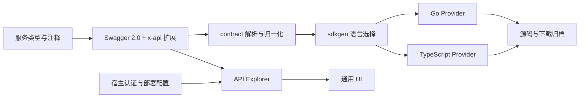

# 架构与模块边界

同一 Swagger 2.0 契约供前端阅读、调试和导出，也供语言 Provider 生成客户端操作与类型。Go 生成器与 React 工作台分属编译期和浏览器运行期，通过契约约定协同，版本一起发布。

| 目录 | 所有权 |
| --- | --- |
| `contract/` | Go 契约结构、公共名称和方法目录；不识别业务路径 |
| `sdkgen/` | Provider 协议、语言选择、统一读取与执行 |
| `sdkgen/{golang,typescript}/` | 语言类型映射、注释、服务和方法输出、归档规则 |
| `sdkgen/artifact/` | ZIP 遍历、确定性输出与归档目标 |
| `frontend/src/` | React 工作台、无 UI 的 core、契约及请求/导出处理 |
| `frontend/packages/ui/` | 通用控件、编辑器、主题和语言资源 |
| `frontend/demo/` | 独立 Inventory 示例，无外部业务依赖 |
| `test/`、`frontend/test/` | Go 公开入口及前端契约/构建测试 |
| `script/`、`.github/workflows/` | 初始化、验证、统一打包与版本发布 |

Go 库只依赖标准库。前端公开包只导出 `dist`，React 保持 peer dependency；UI 由工作台和宿主共同消费。宿主提供业务命名、SDK 输出位置、运行时客户端、契约加载、认证、路径前缀和区域配置，本仓库不持有业务服务实现或真实访问凭据。
