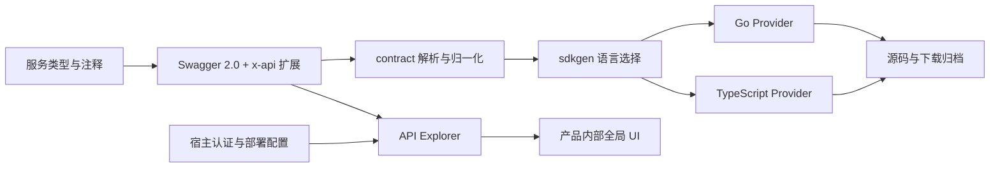

# 架构与模块边界

API Explorer 是一个完整产品，内置可挂载前端与 SDK 生成命令。同一 Swagger 2.0 契约供前端阅读、调试和导出，也供语言 Provider 生成客户端操作与类型。Go 生成器与 React 工作台分属编译期和浏览器运行期，通过契约约定协同，版本一起发布。

| 目录 | 所有权 |
| --- | --- |
| `explorer.go`、`cmd/api-explorer/` | 完整前端的挂载、导出与 SDK 命令 |
| `sdkgen/project/` | 一次生成完整 SDK 工程及通用客户端运行时 |
| `contract/` | Go 契约结构、公共名称和方法目录；不识别业务路径 |
| `sdkgen/` | Provider 协议、语言选择、统一读取与执行 |
| `sdkgen/{golang,typescript}/` | 语言类型映射、注释、客户端配置与 URL、服务和方法输出、归档规则 |
| `sdkgen/artifact/` | ZIP 遍历、确定性输出与归档目标 |
| `frontend/src/` | React 工作台、无 UI 的 core、契约及请求/导出处理 |
| `frontend/src/ui/` | 通用控件、编辑器、主题和语言资源 |
| `frontend/demo/` | 独立 Inventory 示例，无外部业务依赖 |
| `test/`、`frontend/test/` | Go 公开入口及前端契约/构建测试 |
| `script/`、`.github/workflows/` | 初始化、验证、统一打包与版本发布 |

Go 库只依赖标准库。前端公开包只导出 `dist` 与完整页面 `assets`，React 保持 peer dependency；全局 UI 归产品内部，只有一个前端包；已有宿主可通过其子路径复用控件。默认命令已提供 SDK 运行时与命名；需要定制时由宿主提供业务命名、SDK 输出位置、专属运行时、契约加载、认证、路径前缀和区域配置，本仓库不持有业务服务实现或真实访问凭据。

## 前端构建与运行边界

统一前端构建输出 React 定制入口和 `frontend/assets/` 完整静态页面。根 Go 包通过 embed 内置页面，`Handler` 直接挂载，`api-explorer assets` 可导出目录交给任意静态服务器。安装不触发用户侧前端构建。唯一 npm 包包含同样的页面以及 React、core 和 UI 子路径；UI 没有独立包和发布生命周期。

`api-explorer sdk` 使用 `sdkgen/project` 组合已有 Provider 与通用客户端模板，默认交付可编译的 Go / TypeScript 工程；高级消费者可继续使用 Provider 接入专属运行时。CLI 和 Go 包共享同一个产品版本。

浏览器加载页面后才调用 `host.loadSpecification()`，根据契约生成接口目录、Schema 展示和请求表单；Swagger 不参与生成 React 源文件。后端契约更新与前端组件升级因此分别交付。SDK Provider 在 Go 进程中生成客户端源码，既不编译 React，也不注册静态资源路由。

构建命令、产物目录、全新宿主示例、Go 嵌入及运行流程图见[前端资源指南](../guide/frontend-resources.md)。
