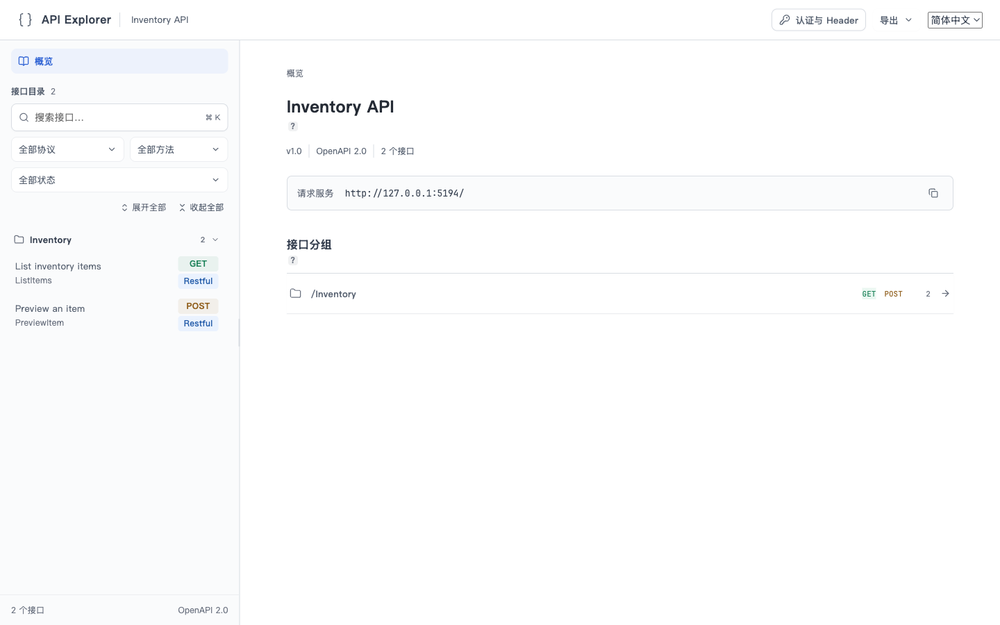
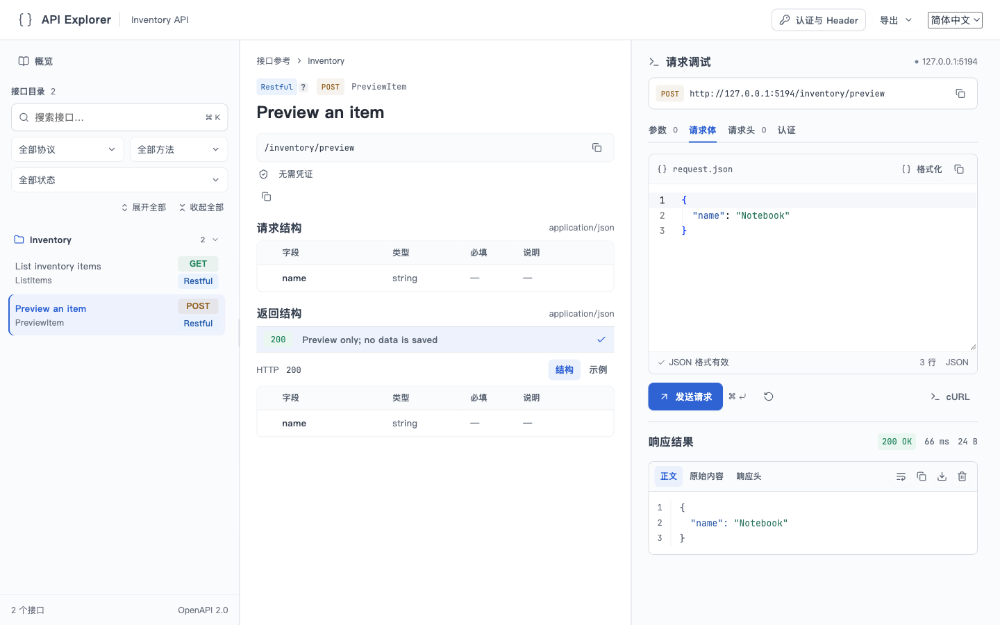
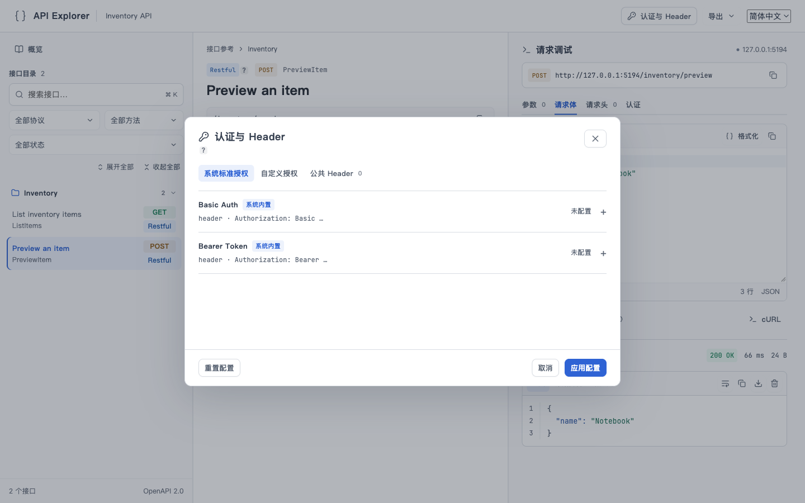
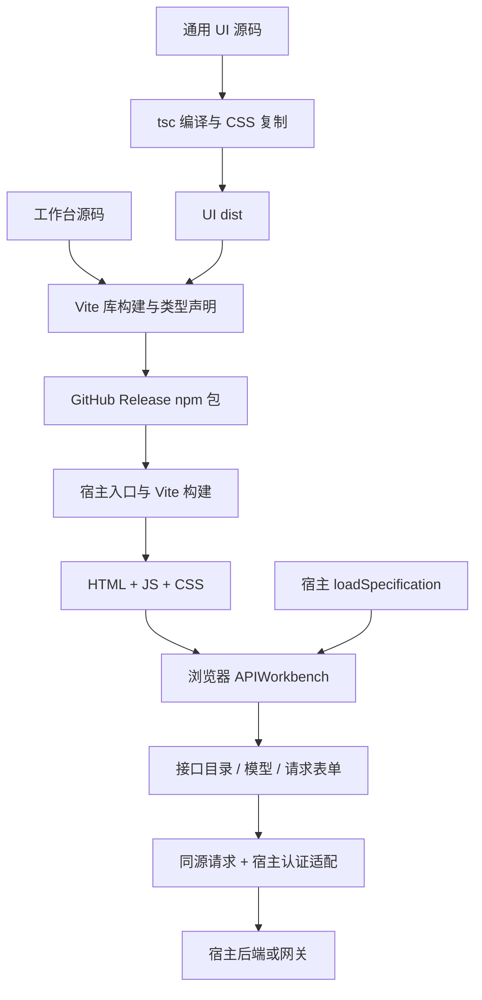

# 前端资源：构建、接入与部署

如果你已有一个 HTTP 服务，希望用户打开网页就能查接口、填参数并发送请求，使用本项目的 API Explorer 即可。

- **API Explorer（`@api-explorer/react`）**：完整的接口文档与调试界面。`APIWorkbench` 是它在代码中的组件名。它负责读取接口描述、列出接口、展示字段和发送请求，接入者不用自己编写这些页面。
- **通用 UI（`@workbench/ui`）**：下拉选择、复制按钮、JSON 展示与 JSON 编辑器等独立界面控件。它们不理解接口业务；例如 JSON 编辑器能编辑一段 JSON，但不知道这段 JSON 应该发送给哪个接口。API Explorer 在内部使用这些控件，其他页面也可单独使用。
- **宿主项目**：安装并展示这个页面的你自己的网站或服务，负责页面入口、登录认证和部署。
- **接口契约**：描述接口地址、参数和返回值的 Swagger 2.0 JSON 文件。它是页面的数据来源，不是前端源代码。

只做接口文档页面时，安装 API Explorer 就够了，通用 UI 已包含在内。宿主用 Vite 将组件和自己的页面入口编译为浏览器可用的 HTML、JavaScript、CSS，再交给服务器。浏览器打开页面后加载接口契约，组件据此显示内容；无需针对每份 Swagger 重新生成前端源码。

已有 Swagger UI 的项目先看[功能差异与替换步骤](swagger-ui-migration.md)。以下分别说明维护本工具时如何构建，以及使用本工具的新项目如何接入。

## 页面示例

以下均为本仓库 [`frontend/demo/main.tsx`](../../frontend/demo/main.tsx) 的真实界面截图，视口为 1440 × 900。接口来自虚构的 Inventory 示例，仅访问本机 `127.0.0.1`；没有真实业务数据、账号、Token 或内部服务地址。

### 接口概览

左侧是根据 Swagger 生成的接口目录与筛选项，右侧是 API 名称、版本、服务地址和分组。示例只有“查询数量”和“预览物品”两个接口。



### 查看接口并发送 JSON 请求

左侧选择 `PreviewItem`；中间展示 `name` 字段及返回结构；右侧 JSON 编辑器填写 `{"name":"Notebook"}`，发送后得到本地回显的 `200 OK`。这个接口不保存数据。右侧 JSON 编辑器、复制按钮等属于基础控件，而整个三栏页面才是 API Explorer。



### 认证设置

页面可以集中设置 Basic、Bearer、自定义授权和公共 Header。截图中的凭证均为“未配置”；Inventory 示例不要求认证，因此没有填写或展示任何真实凭证。



复现这些画面：按下文启动本地示例，将右上角语言切换为“简体中文”；打开概览，或选择 `Preview an item` 并点击“发送请求”；点击顶部“认证与 Header”查看设置。

## 1. 分清构建产物

| 产物 | 生成命令（仓库根执行） | 输出与用途 |
| --- | --- | --- |
| 通用 UI | `npm --prefix frontend run build:ui` | `frontend/packages/ui/dist/`，供其他 React 项目导入的控件与声明 |
| API Explorer 组件库 | `npm --prefix frontend run build` | `frontend/dist/`，包含 `index.js`、`core.js`、`api-explorer.css`、类型声明与字体许可；同时先构建 UI |
| Inventory 示例站点 | 先构建组件库，再执行 `npm --prefix frontend run build:demo` | `frontend/dist-demo/index.html` 与 `assets/`，可由 HTTP 服务托管的示例页面 |
| 配套分发包 | 完成构建检查后执行 `./script/package.sh v0.1.1` | `.artifacts/release/{api-explorer-react.tgz,workbench-ui.tgz,SHA256SUMS}`，供 npm 安装 |
| 接入项目的页面 | 在接入项目执行自己的 `npm run build` | 由接入项目配置，例如 `dist/index.html` 与 `dist/assets/`，交给该项目的后端或静态服务器 |

组件库 `frontend/dist/` 没有页面入口 `index.html`，不能直接当网站部署。`dist-demo/` 是 Inventory 示例；接入业务系统时应使用自己的契约加载、认证与服务路由。

### 从源码构建与查看示例

环境要求 Node.js 24、npm。在本仓库根目录执行：

```bash
npm --prefix frontend ci
npm --prefix frontend run build
npm --prefix frontend test
npm --prefix frontend run dev
```

打开 `http://127.0.0.1:5194`。示例通过公开包入口使用刚生成的 `dist`；修改组件或 UI 后，重新执行 `npm --prefix frontend run build`。

构建并预览示例静态页面：

```bash
npm --prefix frontend run build:demo
cd frontend
npm exec -- vite preview --config vite.demo.config.ts --host 127.0.0.1 --port 5194
```

示例的 `/inventory/items` 计数与 `/inventory/preview` 回显由 `vite.demo.config.ts` 的开发/预览中间件提供。将 `dist-demo/` 复制到普通静态服务器只会得到页面，这两个接口不会随 HTML 一起部署。

### 生成 GitHub Release 安装包

```bash
GO_BIN=/path/to/go1.26.4/bin/go ./script/check.sh
./script/package.sh v0.1.1
```

`check.sh` 执行 Go 测试、前端构建与测试。`package.sh` 校验两个包及锁文件版本，打包已有 `dist` 并生成 SHA256；它使用 `--ignore-scripts`，不会自行重新构建，必须先执行上述检查。tag 要与包版本相同。

GitHub 工作流 `.github/workflows/ci.yml` 在 main/PR 验证并上传构建附件；推送新版本 tag 时，验证成功后创建同名 Release，发布两个 `.tgz` 和校验文件。普通文档提交不产生新 Release，不覆盖已发布资产。

## 2. 新项目从零接入

下面建立一个独立 React 页面，无需复制本仓库源码，也不需要 Go 生成器。已有 React 项目只需安装组件包并合入页面与配置。

### 安装与文件布局

在新目录执行（Node.js 24）：

```bash
mkdir api-docs-web
cd api-docs-web
npm init -y
npm pkg set type=module scripts.dev="vite --host 127.0.0.1 --port 5194" scripts.build="vite build" scripts.preview="vite preview --host 127.0.0.1 --port 5194"
npm install --save-exact react@19.2.8 react-dom@19.2.8
npm install https://github.com/PerfectZQ/openapi-workbench/releases/download/v0.1.1/api-explorer-react.tgz
npm install --save-dev --save-exact vite@8.2.1 @vitejs/plugin-react@6.0.5 typescript@7.0.2 @types/react@19.2.18 @types/react-dom@19.2.4
mkdir src public
```

创建以下文件，提交 `package.json` 与 `package-lock.json`。后续构建使用 `npm ci` 复现依赖。

```text
api-docs-web/
  index.html
  vite.config.ts
  src/main.tsx
  public/openapi.json
  package.json
  package-lock.json
```

`index.html`：

```html
<!doctype html>
<html lang="zh-CN">
  <head>
    <meta charset="UTF-8" />
    <meta name="viewport" content="width=device-width, initial-scale=1.0" />
    <title>API Explorer</title>
  </head>
  <body>
    <div id="root"></div>
    <script type="module" src="/src/main.tsx"></script>
  </body>
</html>
```

`src/main.tsx`：

```tsx
import { createRoot } from 'react-dom/client'
import { APIWorkbench, type APIWorkbenchHost } from '@api-explorer/react'
import { publicSpecification } from '@api-explorer/react/core'
import '@api-explorer/react/style.css'

const host: APIWorkbenchHost = {
  async loadSpecification() {
    const response = await fetch('./openapi.json', {
      cache: 'no-store', redirect: 'error',
    })
    if (!response.ok) throw new Error(`契约加载失败：HTTP ${response.status}`)
    return publicSpecification(await response.json(), window.location.origin)
  },
}

createRoot(document.getElementById('root')!).render(
  <APIWorkbench host={host} locale="zh-CN" />,
)
```

`public/openapi.json`（最小 Swagger 2.0，替换成自己的契约）：

```json
{
  "swagger": "2.0",
  "info": { "title": "Example API", "version": "1.0.0" },
  "basePath": "/",
  "paths": {
    "/api/ping": {
      "get": {
        "operationId": "Ping",
        "summary": "检查服务状态",
        "responses": { "200": { "description": "服务正常" } }
      }
    }
  },
  "definitions": {}
}
```

`vite.config.ts`：

```ts
import { defineConfig } from 'vite'
import react from '@vitejs/plugin-react'
import { readFileSync } from 'node:fs'

export default defineConfig({
  base: './',
  plugins: [react(), {
    name: 'api-explorer-license',
    generateBundle() {
      this.emitFile({
        type: 'asset', fileName: 'JetBrainsMono-OFL.txt',
        source: readFileSync(new URL(import.meta.resolve('@api-explorer/react/licenses/JetBrainsMono-OFL.txt'))),
      })
    },
  }],
  resolve: { dedupe: ['react', 'react-dom'] },
  server: { proxy: { '/api': 'http://127.0.0.1:8080' } },
})
```

`base: './'` 使静态资源能放在 `/api-explorer/` 等子路径下；它不修改契约中的 API 路径。许可插件将组件附带的字体许可复制到宿主产物。

```bash
npm run dev
npm run build
npm run preview
```

开发时打开 `http://127.0.0.1:5194/`，应看到 Example API 和 Ping。点击发送需要实际后端实现 `GET /api/ping`，Vite 开发服务器将 `/api` 转发到 8080。生产部署需由后端或网关提供同样的 API 路由；开发代理不会被打包进静态资源。没有后端仍可浏览契约。

### 静态文件或动态契约

上例把公开契约放在 `public/`，Vite 构建时复制到 `dist/openapi.json`。如需由后端动态提供或鉴权，把 `loadSpecification` 的地址改成后端契约端点，例如 `/api/openapi.json`，并在该回调中添加宿主所需凭证。不要同时把受保护契约留在公开 `public/` 目录。

接口契约内容变化时，页面下次加载会读取新契约；动态契约通常无需重建前端。更改组件版本、宿主配置或随页面打包的静态契约则需要重新构建部署。

## 3. 部署给后端使用

将接入项目的完整 `dist/` 一起部署，包含 `index.html`、`assets/`、静态契约和许可文件。页面使用 Hash 定位接口，不需要为每个接口配置独立 HTML 路由。子路径入口应保留尾部 `/`，例如 `/api-explorer/`，保证 `./assets/` 和 `./openapi.json` 正确解析。

Go 服务可以将上述页面嵌入二进制。在接入项目根目录创建 `main.go`（`dist/` 与其同级），例如：

```go
package main

import (
    "embed"
    "io/fs"
    "log"
    "net/http"
)

//go:embed all:dist
var assets embed.FS

func main() {
    files, err := fs.Sub(assets, "dist")
    if err != nil { log.Fatal(err) }
    mux := http.NewServeMux()
    mux.Handle("/api-explorer/", http.StripPrefix("/api-explorer/", http.FileServerFS(files)))
    mux.HandleFunc("GET /api/ping", func(w http.ResponseWriter, r *http.Request) {
        w.Header().Set("Content-Type", "application/json")
        _, _ = w.Write([]byte(`{"ok":true}`))
    })
    log.Fatal(http.ListenAndServe(":8080", mux))
}
```

```bash
npm run build
go run main.go
```

打开 `http://127.0.0.1:8080/api-explorer/` 即可浏览并调用 Ping。使用 Go 1.26.4；嵌入文件必须先存在，更新页面后需重新编译部署 Go 服务。已有服务只合入路由与嵌入声明，认证和访问权限仍由该服务负责。

## 4. 原理与宿主职责



构建期将 React 组件、通用控件、语言资源、Monaco 编辑器及其 Worker 打成库，React / React DOM 保留为 peer dependencies，由宿主提供。`core.js` 独立构建，只含契约、路径、请求和导出逻辑，不加载 React、CSS 或编辑器。组件包与 `@workbench/ui` 的具体导出以各自 `package.json` 为准。

运行时 `APIWorkbench` 调用稳定的 `host.loadSpecification()`，把返回契约投影为目录、详情、Schema 与参数编辑器。提交请求时共用参数解析、校验与 Header 计算，限制同源且拒绝重定向。更换接口契约不会生成另一套组件源码。

| 宿主能力 | 接入位置与边界 |
| --- | --- |
| 契约读取与加载鉴权 | `loadSpecification()`；该回调自行取票与处理加载失败，调试认证配置不会自动作用于它 |
| 调试请求自动认证 | `request.authentication`，声明匹配契约的 scheme、Header、`getHeaders()` 和可选 `onUnauthorized()`；手工凭证优先，401 不自动重放 |
| 时间戳等 Header | `request.automaticHeaders(api, values)`，统一用于预览、cURL 和发送 |
| 公共路径与网关 | `publicSpecification(spec, location.origin, mapPath)` 和 `replacePathPrefix`；同时处理 `paths` 与 `x-api-actions`，不创建代理或后端路由 |
| SDK 下载 | 可选 `loadSDK(language)` 返回 Blob，只有提供时才显示下载；生成 SDK 的过程独立于页面构建 |
| InnerTOP 导出 | 可选 `innerTOP` 配置；生成导入文件，不替宿主调用平台发布或授权 |
| 语言与页面外壳 | `locale`、`headerActions`；工作台是全页组件，会使用 Hash 并更新标题，应安排独立页面入口 |

完整类型见 [`frontend/src/host.ts`](../../frontend/src/host.ts)，最小可运行接入见 [`frontend/demo/main.tsx`](../../frontend/demo/main.tsx)。接口与模型的 Go / TypeScript 源码生成走 [SDK Provider](../development/sdk-generation.md)，与静态页面构建是两条独立流程。

### 单独复用通用 UI

普通 API Explorer 接入只安装 `api-explorer-react.tgz`；该组件包已经包含需要的 UI。宿主其他页面要独立复用控件时，再安装 `workbench-ui.tgz`，从 `@workbench/ui/*` 导入公开入口，并满足包声明的 peer dependencies。

UI 包使用 tsc 输出，保留 Monaco 的 `?worker&inline` 导入，由宿主 Vite 转换。直接消费该包的应用使用以下配置，并按控件需要提供样式、主题和 i18n 上下文：

```ts
resolve: { dedupe: ['react', 'react-dom', 'react-i18next', 'monaco-editor', 'motion'] },
optimizeDeps: { exclude: ['@workbench/ui'] },
```

## 5. 常见问题

| 现象 | 检查 |
| --- | --- |
| 构建后找不到 HTML | `npm --prefix frontend run build` 生成组件库；示例用 `build:demo`，业务页面在宿主构建 |
| 页面无样式 | 是否导入 `@api-explorer/react/style.css`，是否一并部署 CSS 与字体资源 |
| 子路径加载 JS 或契约 404 | 宿主 Vite 的 `base`、页面尾部 `/`、文件服务的路径前缀与 `loadSpecification` 是否一致 |
| 契约能展示，但发送请求 404 | Swagger 只描述接口；后端实现、开发代理与生产网关路由必须分别存在 |
| 契约加载 401，调试取票似乎无效 | `loadSpecification` 与调试请求是独立入口，分别配置加载凭证和 `request.authentication` |
| 点击发送提示同源限制 | 通过宿主同源网关代理目标服务，再映射契约公共路径 |
| UI 编辑器 Worker 构建失败 | 直接使用 UI 包时检查 `optimizeDeps.exclude`；不要绕过 exports 导入内部源码 |
| 组件更新后示例仍旧 | 示例读取已构建的 `dist`，先重新构建组件库再刷新 |
| SDK 更新但页面未变化 | SDK 源码生成不构建页面；更新前端依赖/配置后执行宿主前端构建与部署 |
