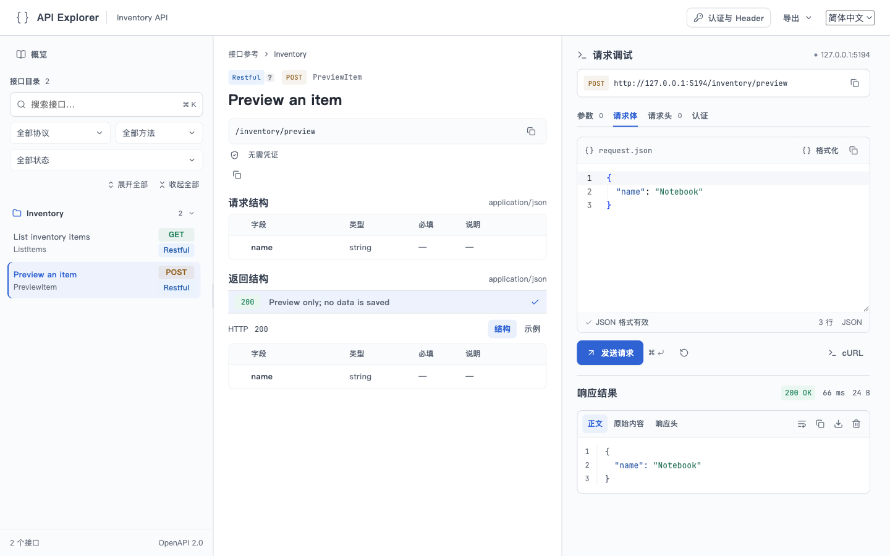
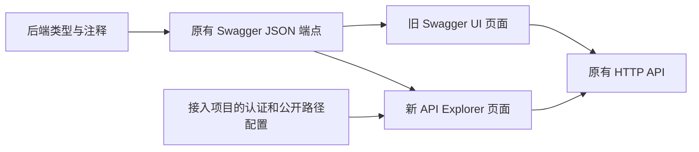

# 与 Swagger UI 的区别和替换步骤

Swagger UI 是根据接口描述文件生成交互式文档的现成页面。API Explorer 做的是同类工作：读接口描述、展示文档、让用户填写参数并发送请求。API Explorer 是基于 Swagger 的扩展产品，拥有自己的完整界面、请求处理和 SDK 生成能力。

替换的是浏览器中的文档与调试界面。后端 HTTP 接口、Swagger JSON 生成过程、访问权限仍由原服务负责；不能通过替换页面让服务自动增加接口或获得授权。

本文比较标准 Swagger UI 的公开能力与本仓库当前实现，不把某个业务项目的定制行为当成 Swagger UI 默认能力。

下图展示替换后的实际界面：左侧接口目录、中间接口参考、右侧请求调试。截图使用仓库自带的虚构 Inventory 示例，只发送本地回显请求；更多画面见[页面示例](frontend-resources.md#页面示例)。



## 1. 两者做什么，有什么差异

两者都能根据接口描述展示 API、参数、响应模型，并提供 HTTP 请求调试。区别主要在以下方面：

| 维度 | 标准 Swagger UI | 本项目 API Explorer |
| --- | --- | --- |
| 接口描述格式 | 支持 Swagger 2.0 与 OpenAPI 3 系列，具体版本取决于所装版本 | 当前实现针对 Swagger 2.0 JSON 及下述自定义扩展；不承诺 OpenAPI 3 兼容 |
| 页面组织 | 标准布局按标签与接口展开，也可自定义布局 | 接口目录、接口参考和请求调试分区，包含 Schema 引用展示、JSON 编辑器、中英文界面 |
| 接入入口 | 调用 `SwaggerUIBundle` 或使用 `swagger-ui-react`，传入 URL 或契约对象 | 直接挂载内置页面并指定 Swagger 地址；React 定制通过 `APIWorkbench` |
| 契约地址和加载认证 | 可使用 `url`、`spec`、配置文档与拦截器 | 默认页面读取指定 Swagger 地址，使用同源登录会话；特殊取票或路径映射可通过 React 定制 |
| 调试目标 | 可按契约配置请求目标；跨域需后端满足浏览器 CORS 规则 | 请求限制在当前页面同源地址，并拒绝重定向；跨域服务通过同源后端网关接入 |
| 请求认证 | 根据安全定义提供认证，支持 OAuth 相关配置 | 提供 Basic、Bearer、契约声明的凭证字段及自定义 Header；自动取票走宿主回调，没有内置 OAuth 登录流程 |
| 凭证保存 | `persistAuthorization` 可配置，默认关闭 | 当前只保留在页面内存，没有持久化开关；手工凭证优先于自动身份，401 不自动重放 |
| 扩展方式 | 提供 plugins、presets、layout、request/response interceptor 等扩展点 | 使用 `APIWorkbenchHost` 的有限接口，不兼容 Swagger UI 插件和配置对象 |
| SDK | 页面本身与客户端生成是不同工具职责 | 同一个 `api-explorer sdk` 命令生成 Go / TypeScript SDK；不在浏览器编译 SDK |
| 业务 Action 接口 | 标准 Swagger 以 path + method 描述操作，业务扩展需要定制处理 | 识别 `x-api-actions`、`x-api-action` 等扩展，把逻辑 Action 转成实际 Query 参数请求 |
| 生命周期与枚举说明 | 标准字段与扩展的显示取决于实现及配置 | 识别标准 `deprecated`、`x-api-lifecycle`，以及实现支持的枚举说明扩展 |
| InnerTOP | 不属于标准 Swagger UI 协议能力 | 宿主配置 `innerTOP` 后可导出导入文件；不会自动在平台创建服务或授予权限 |

Swagger UI 的协议范围见[官方产品说明](https://swagger.io/open-source/swagger-ui/)；URL、认证持久化、拦截器和插件配置见[官方配置说明](https://swagger.io/docs/open-source-tools/swagger-ui/usage/configuration/)，OAuth 入口见[官方 OAuth 文档](https://swagger.io/docs/open-source-tools/swagger-ui/usage/oauth2/)。本项目能力以 [`host.ts`](../../frontend/src/host.ts)、[`contract.ts`](../../frontend/src/contract.ts)、[`request.ts`](../../frontend/src/request.ts) 和 [`authorization.ts`](../../frontend/src/authorization.ts) 为准。

### 当前不能按“直接替换”处理的情况

- **OpenAPI 3、YAML 或完整 JSON Schema 支持**：当前加载接口接收 Swagger 2.0 对象，示例使用 `response.json()`，没有内置 YAML 解析或 OpenAPI 3 转换器。不要仅改文件扩展名或版本字段。
- **OAuth 跳转、多个契约切换、已有 Swagger UI 插件**：当前没有对应的兼容配置，需要由接入项目实现所需交互，或继续保留原页面。
- **表单与上传**：当前请求组装处理 path、query、header 和 JSON body；未实现通用 `formData` / multipart 文件上传。看到参数不等于能正确发送上传请求。
- **原有 URL Hash 收藏链接**：两者都可定位接口，但编码规则不同，不能承诺旧 `#/...` 链接直接沿用。
- **只读文档**：没有与 `supportedSubmitMethods: []` 等价的公开开关。不能把前端按钮当成后端访问控制；需要这一页面行为时先补能力或保留旧页面。

这些是替换前要核对的实际边界，不是宣称两者所有特性等价。普通 Swagger 2.0 JSON 接口不必为了使用页面添加业务扩展。

## 2. 替换发生在哪一层



可以先让新旧页面使用同一份契约并行验证，再将原文档 URL 指向新页面。契约生成器不必随之更换；Go 项目仍可沿用 swag/goswag。即使后端还用带 `swagger` 名字的包输出 JSON，也不代表浏览器仍使用 Swagger UI；要看 HTML 实际加载的脚本和 React 入口。

**原先（示意）**：

```ts
SwaggerUIBundle({ url: '/openapi.json', dom_id: '#swagger-ui' })
```

**替换后**：

```bash
api-explorer assets --spec /openapi.json --out ./public/api-explorer
```

将输出目录挂载到原来的文档页面路径即可。Go 可直接挂载 `explorer.Handler("/openapi.json")`；完整示例见[接入指南](quick-start.md)。不需要建立 React 工程、编写 HTML 或配置 Vite。

## 3. 特殊配置如何迁移

以下回调用于已有定制需求的 React 接入；普通安装只需指定 Swagger 地址。

| 旧配置或职责 | 新接入位置 | 迁移时要做什么 |
| --- | --- | --- |
| `url` 或 `spec` | `host.loadSpecification()` | 请求同一契约端点，或直接返回已有对象；返回 Promise |
| `requestInterceptor` 给契约取票 | `loadSpecification()` 内的 fetch headers | 显式添加加载凭证，处理 401/403；不会自动复用下面的调试取票 |
| `requestInterceptor` 给 API 调试取票 | `host.request.authentication` | 设置与契约匹配的 scheme、Header、`getHeaders` 和可选 401 回调 |
| 时间戳、签名之外的固定自动 Header | `host.request.automaticHeaders` | 返回实际需要的 Header；该接口不是任意请求拦截器，不可在此改 URL 或 body |
| 服务公共路径、反向代理前缀 | `publicSpecification` 与 `replacePathPrefix` | 映射真实 API 路径；同时在网关配置同源路由，路径函数本身不转发请求 |
| 语言切换与页面顶部操作 | `locale`、`headerActions` | 接入项目传入语言与自己的按钮；页面内部使用独立 i18n 实例 |
| `plugins`、`presets`、`layout`、`responseInterceptor`、`initOAuth` | 没有同名兼容入口 | 逐项评估用途，不能原样复制配置 |
| `deepLinking` 与页面路由 | API Explorer 使用自己的 Hash | 给它独立页面，验证旧链接需求；避免同时占用宿主 Hash 路由 |

API 请求的认证和契约文件的访问权限必须分别保留。宿主的登录页、取票方法、权限检查不属于组件包；服务端也必须继续验证每次 API 请求。

## 4. 按什么顺序替换

1. 确认实际契约是支持范围内的 Swagger 2.0；列出上传、OAuth、自定义插件等现有使用点，按上面的边界评估。
2. 安装 API Explorer，导出或直接挂载内置页面，指定现有 Swagger 地址；先保留旧页面用于核对。
3. 迁移契约加载认证、API 调试取票、自动 Header 和网关路径，保持后端权限检查不变。
4. 将旧文档页面路由指向产品自带资源；Go 直接挂载方式需要重新编译服务。
5. 在实际环境核对契约加载、关键接口参数和响应、凭证优先级、401/403、网关前缀与子路径资源。确认原页面依赖的能力有对应实现后再切换入口。
6. 删除不再使用的 `swagger-ui` / `swagger-ui-react` 前端依赖、初始化代码和旧资源复制步骤；仍承担 Swagger JSON 输出的后端包继续保留。

前端构建通过只证明资源可生成；真实登录、后端授权和业务请求需要在接入环境验证。Go / TypeScript SDK 的生成与页面切换独立，不需要为了换页面重生成客户端。
